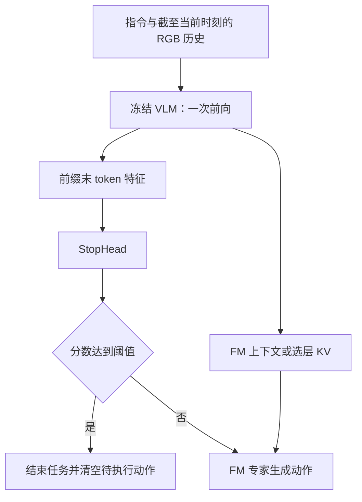

# BetaModel：FM + StopHead 设计

状态：2026-09-24 已实现第一版 `fm_stop`，下文保留设计依据；可执行配置与命令见
[TRAIN_BETANAV.md](TRAIN_BETANAV.md#fm--stophead)。CPU 回归覆盖两种专家架构、标签审计、
独立优化与恢复、单次主干推理和任务停止锁存；真实导航效果仍需训练与评测。
目标是在冻结 LightNav VLM 的条件下，让连续导航策略学习任务终止，并保持每次策略更新只运行一次 VLM。

## 1. 第一版决策

| 项目 | 设计 |
| --- | --- |
| 训练模式 | 新增 `training_mode: fm_stop`；既有 `fm_only` / `ce_fm` 行为保持 |
| 主干 | 完整 VLM 冻结，`eval()` / `no_grad()` |
| 停止输入 | 输入前缀最后一个有效 token 的最终层特征，`detach` 后交给独立分类头 |
| 停止网络 | `LayerNorm(D) → Linear(D,256) → SiLU → Linear(256,1)` |
| 输出 | 一个 stop logit；sigmoid 分数与运行阈值比较 |
| 训练 | FM 专家和 StopHead 分别接受自己的损失、优化器及裁剪 |
| 推理 | 一次 VLM 编码 → StopHead → 只为 CONTINUE 样本执行 FM |
| 停止语义 | 请求结束当前任务；区别于暂时零速度、避障等待、超时或异常 |
| 兼容 | 支持 `cross_attention_v1`、`prefix_kv_v1`，继承所加载 FM 的 horizon、提示和归一化 |

新增头默认关闭；不改变已有训练配置、正在运行的实验、数据或 checkpoint。
第一版面向 `fm_stop`，不同时引入 `ce_fm + StopHead` 的额外组合。



## 2. 共享特征与接口

沿用当前连续轨迹 prompt 和 SlowFast 历史，不添加需要生成的 STOP 文本，也不调用 RVQ decoder。
`D` 从 `vlm.config.text_config.hidden_size` 读取。当前 Light checkpoint 的 `D=2560`，
上述头约有 66.1 万参数；这是参数量估计，不是延迟测量。
新头参数与 Adam 状态保持 FP32，头内部将 detached 特征转换到相应精度。

训练时按 `attention_mask & (position < answer_start)` 选择最后一个有效前缀位置。
不能直接使用序列最后一个 token：padding 和 teacher-forced 回答都可能在那里。
终止标签、剩余 GT 长度、未来帧有效 mask、episode 总长度均不作为头的输入。

- `cross_attention_v1`：复用已经计算的 `last_hidden_state`。
- `prefix_kv_v1`：接住现有 backbone 前向的返回值，从同一次调用中提取 summary；继续保留选定层 KV。
- 不启用 `output_hidden_states=True`；不保存所有层隐藏状态。
- 只保留独立存储的 `[B,D]` summary，避免一个切片引用整个 `[B,N,D]` 底层存储。
- summary 的提取与停止损失不放在 `fm_count > 0` 分支内，确保终止帧参与学习。

建议新增 wrapper，避免改变旧上下文类与低层接口的含义：

```python
@dataclass
class BetaStopContext:
    motion: BetaContext | PrefixKVContext
    stop_features: Tensor  # [B,D]，只有输入前缀的信息

encode_stop_context(prompt_inputs) -> BetaStopContext
predict_stop_logits(context) -> Tensor  # [B]
predict_continuous(prompt_inputs, *, stop_threshold, generator) -> BetaContinuousPrediction
```

内部共用一个编码实现，同时返回 motion context 和 summary；不能分别调用一次 VLM 来构造它们。
训练也共用同一特征提取实现，但 StopHead 本身必须在可求导区域运行。
既有 `encode_context()` / `sample_actions()` 保持可用于不带停止判定的动作诊断。

`BetaContinuousPrediction` 至少包含 `stop_logits`、`stop_scores`、`stop`、
`se2_deltas`、`waypoints`。对 STOP 行返回零轨迹只是协议占位，执行方必须以 `stop` 为准。
batch 中先选出 CONTINUE 行，再对其上下文、KV 和有效 mask 做一致切片。
随机数协议需明确：单个 `torch.Generator` 不能按行切片。存在 CONTINUE 行时，
先按原 batch 形状生成初始噪声，再对噪声做相同切片并传给专家；每个请求的 seed/step 记录固定。
这样相同请求的 STOP 行数变化不会挤占其他行的噪声位置。全 STOP 时不生成 FM 噪声。
所有行都 STOP 时不执行 FM；一轮请求中 VLM 调用数仍为一。

## 3. STOP 标签契约

监督单位是当前帧是否应结束，而非每个 FM 积分步，也非未来动作块的 padding。
第一版学习经过审计的成功专家轨迹中的终止时刻，不把评测成功半径内所有位置自动改成 STOP。
示范停止时刻和评测容许区域并不完全相同，需分别报告评价结果。

新增独立 batch 字段：

```text
stop_target:     float32[B]，0=CONTINUE，1=STOP
stop_valid_mask: bool[B]，表示该停止标签可用于训练
```

| 样本 | 标签 | 有效性 |
| --- | --- | --- |
| 经确认成功结束、原始显式 STOP 为真的终止帧 | 1 | 有效 |
| 同一可靠完整示范中有真实后继、未标 STOP 的非末帧 | 0 | 有效 |
| 不足完整 RVQ chunk 的非末帧，但确有下一帧 | 0 | 有效，不能因 RVQ 无效而删掉 |
| 截断、失败或终止原因未知的末帧 | 占位 0 | 无效，不计算分类损失 |
| 数据字段互相矛盾，例如中途显式 STOP | 不使用 | 数据校验报错，不静默改标签 |

当前可利用 `action.explicit_stop`、`action.stop_loss_valid` 及
`meta/provenance/episodes/<episode>/episode.json` 中的终止审计信息。
数据准备阶段检查来源格式、成功终止标志与 episode/frame 对齐，保存标签契约版本、
来源指纹、正负/无效计数，训练 worker 不反复读取大份 provenance。
旧数据没有必要字段时保留旧模式可用，但不能静默启用 `fm_stop`。
标签适配代码属于训练数据 reader / `lightnav.training.prepare_data`，不依赖 `data_pipeline/` Python 包。
若将来需要重新采集或新增生成标签，生成逻辑仍放在 `data_pipeline/R2R/`。

必须避免三种错误：

1. 当前 `sample_info.explicit_stop` 由“是否末帧”推算，不能独立作为成功终止的证明。
2. 当前 `action.stop_loss_valid` 只标 STOP 正例，不能直接作为 BCE 的有效 mask。
3. `fm_valid.any()` 不能作为 STOP 有效 mask，否则会屏蔽所有终止正例。

FM 的末帧 mask 继续全 False。不把缺失未来帧补成有效的零动作。
StopHead 的正例、负例和 FM 动作分别监督，不把 STOP 当成连续动作的第四个坐标。

## 4. 损失、梯度与训练更新

```text
L_total = lambda_fm * L_fm + lambda_stop * L_stop
L_stop = sum(valid_i * weight_i * BCEWithLogits(logit_i, target_i))
         / sum(valid_i * weight_i)
```

`L_fm` 沿用当前真实动作有效 mask 和全局归一化。
STOP 正负失衡优先通过固定权重处理，第一版不改变原有帧采样顺序，避免顺带改变 FM 数据分布。
`weight_i` 对负例为 1、正例为训练 manifest 中固定的 `N_negative / N_positive`；
要求两类计数都大于零。使用逐元素 BCE 后显式乘权重并归一化，不与框架默认 reduction 混用。
正例权重、标签版本、manifest 指纹进入恢复契约；中途不按 batch 类别比例动态修改。

加权损失下的 sigmoid 值先称为 `stop_score`，不能默认解释为校准后的成功概率。
阈值通过后述开发评估确定；`0.5` 仅是可运行的初始值，不保证最佳。

| 损失 | 更新参数 | 不更新 |
| --- | --- | --- |
| FM | 动作专家，旧架构含自己的 context projection | VLM、StopHead |
| STOP | StopHead 的 LayerNorm 和 MLP | VLM、FM 专家及其 projection |

StopHead 接 raw detached VLM summary，不接 FM 的可训练 context projection，避免间接耦合两种梯度。
初始建议为 `lambda_stop=1.0`、`lr_stop=1e-4`、`clip_stop=1.0`、无 dropout，
其余 AdamW 设置与独立训练环境中的现有约定一致。这些是实验起点，不是验证过的最优值。
FM 的权重、学习率、horizon、归一化和积分时间分布从所选基线继承。

DDP / 梯度累积必须沿用当前“先累积局部和、再按窗口全局有效量缩放”的实现，扩展到第三个参数组：

- 每个微批反传 `lambda_stop * stop_loss * local_stop_weight_sum`，不缓存整窗口的图像来预先计数。
- 窗口结束后 all-reduce 得到 `global_stop_weight_sum`，将 STOP 组梯度乘以
  `world_size / global_stop_weight_sum`；不能对各 rank 的 loss 均值再平均。
- 当前循环自行管理 accumulation，保持 Accelerator 的 accumulation 为 1，避免重复缩放。
- FM 与 STOP 分别计数、分别决定 optimizer 是否 step。
- 只有 STOP 的窗口仍更新 StopHead；只有 FM 的窗口不对 StopHead 做 AdamW 权重衰减。
- 某 rank 没有本地 STOP 有效样本、其他 rank 有时，为 StopHead 保留零梯度 DDP hook。
- 全局无某分支监督时清除该分支梯度，跳过其 optimizer；完全无监督时所有 optimizer 都不 step。
- 保留当前全局 `state.step` 按已消费累积窗口推进的语义，包括完全无监督窗口；
  数据游标、epoch 和学习率 schedule 也按原约定推进，不改变旧 run 的步数含义。
- FM 和 STOP 学习率使用共同的全局窗口步数计算 schedule，按组另记实际更新次数；
  某组无监督时其 Adam 不 step，但下次有监督时使用当时的全局学习率。纳入精确续训测试。

不能只在配置里加模式名。应统一使用明确的能力判断，例如
`uses_frozen_continuous_backbone(mode)` 覆盖 `fm_only` / `fm_stop`，
并单独判断 `has_stop_head`。逐一更新数据列选择、prompt、BF16 加载、freeze/no_grad、
prefix-KV 允许模式、服务和 Habitat 路由，防止新模式误走 CE/RVQ 路径。

## 5. 推理与执行协议

新观测到来后的一次策略更新：

1. 用现有连续轨迹 prompt 编码一次，得到 summary 和 FM context。
2. 计算 StopHead 分数，与已记录的阈值比较。
3. 若继续，复用 context 采样 FM 动作；积分循环只运行专家，不重复运行 VLM。
4. 若停止，输出显式 `stop=True`，记 `stop_source=learned_head`，不采样 FM。

每次策略更新的主要成本为 `VLM + StopHead + N * FM专家`；STOP 行省略 FM。
动作 horizon、FM 积分步数、策略更新周期和底盘控制周期是四个不同量。
StopHead 只能在收到并编码新观测时判断，过长的开环执行段仍可能错过停止机会。
第一版不额外增加第二个 VLM 请求，也不默认要求连续多帧投票，避免引入未经评估的停止延迟。

服务沿用现有 WebSocket `stop` 字段。新增日志/可选遥测为
`stop_score`、`stop_threshold`、`stop_source` 和分段延迟，不强制旧客户端理解新字段。
已确认完成的 session 保持完成状态，后续请求不重新生成动作；仅明确 reset/新任务解除。
MuJoCo 客户端立即废弃剩余航点和旧请求结果，并使控制器停稳。
完成状态需绑定 session/generation；旧任务的迟到结果不能停止或重启新任务。
当前 MuJoCo 已有显式 STOP 后清路径、重置 MPC 和关闭会话的处理，应优先复用并验证，
不为新增头重写控制器。`stop=True` 的优先级高于同一响应中任何非零航点。

`fm_stop` 运行第一版允许显式选择 `learned`，并保留诊断用的不启用头及 RVQ 对照路径。
旧 checkpoint 请求 `learned` 时立即报错，不能临时随机初始化头后运行。
异常、用户中止、超时、控制受阻分别记录，不能报告成模型判断任务成功。

Habitat 的近零速度可能被适配器解释为 STOP，因此即使 head 判 CONTINUE，
仍要独立记录 `fm_zero_command` / `environment_stop`，不能计入 `learned_head`。
可复用已有非 STOP 动作恢复分支进行明确标注的对照实验，但不能通过未记录的转向来掩盖此问题。
服务端的真实暂时零运动不应自动锁存为任务完成。

## 6. 配置、checkpoint 与实验边界

下面是待实现字段的设计示例，不是当前可运行的 YAML：

```yaml
training_mode: fm_stop
stop_head_type: last_prefix_mlp_v1
stop_hidden_size: 256
lambda_stop: 1.0
lr_stop: 0.0001
clip_stop: 1.0
# stop_positive_weight 从审计后的训练 manifest 解析并固定到恢复契约
# expert_architecture、prefix_layers、fm_horizon、FM 参数沿用选定基线
```

推理增加 `learned` 停止模式和明确的阈值选项；最终 CLI 名称需与
`beta_stop_mode` / `fm_only_stop_mode` 的现有用途统一，并在实现时同步更新 `CONFIGURATION.md`。
阈值、head 版本、标签版本和训练来源随评估结果保存；不隐式改变旧默认值。

- 新模型配置保存 head 架构；模型 state_dict 保存 `stop_head.*`。
- 完整训练 checkpoint 额外保存 STOP Adam/ZeRO 每 rank 分片、scheduler、参数组及计数状态。
- 继续使用更新边界的不可变 CPU 快照、异步写入和既有保留策略，不引入 optimizer consolidation。
- 老 FM 权重可以显式 warm-start 新 `fm_stop` 实验，初始化新头和新训练状态。
  增加头/参数组后不能称为旧任务的精确续训。
  加载时只允许预先声明的 StopHead keys 缺失，原 VLM/FM keys 必须严格匹配；
  不使用宽泛的 `strict=False` 忽略其他结构错误。记录来源，并重建新 run 的 optimizer、RNG 和游标。
- 新 `fm_stop` checkpoint 的 exact resume 要求结构、标签、权重、数据游标和优化器契约匹配。
- 旧 checkpoint 未声明 head 时按旧语义加载；声明 head 却缺失权重必须失败。
- 本设计不修改既有 R2R 全量训练策略、旧 run 的 29,589 目标或 FM-only 的三 epoch 约定。
  新实验的步数由其单独配置确定，不能套用为旧实验的新终点。

## 7. 校准、评估与第一版验收

训练继续使用全部 R2R 训练 episodes，不偷偷新增训练内验证切分。
原有 777 条历史验证 episodes 已并入全量训练，不能再当作独立校准集。
先在训练数据上检查标签与可学习性，这些结果仅作拟合诊断。
阈值调节需要另行固定、可访问的开发 episodes；调节集不能同时作为最终无偏评估集。
新增校准和最终评估按场景隔离，避免同路线的不同指令跨集合；校准时使用自然样本频率。
若没有独立开发集，固定初始阈值并明确报告未校准；不能利用评测 GT 在线决定 STOP。
需要新增 Habitat 数据时只准备命令，遵循项目的数据访问与独立环境约定。

在同一份 FM 权重、相同环境与随机种子约定下比较：不启用学习头、冻结 RVQ STOP、学习 STOP。
离线 oracle-stop 只作为已有轨迹上的诊断参照，不作为可部署模型成绩。
提前终止会改变后续轨迹与观测，因此不同停止模式的完整 rollout OS 也可能不同；
同时保留固定轨迹回放，以区分轨迹改变与停止判断本身的改善。

至少记录：

- 闭环 SR、OS、SPL、nDTW；提前停止、到达后未停止、超时和异常的 episode 数。
- 碰撞率或碰撞计数，避免仅靠更激进的停止/运动行为改善单一终点指标。
- STOP precision/recall、PR 曲线；近终点 CONTINUE 难负例的误报率。
- 首次进入成功区到停止请求的步数/时间，停止请求到实际停稳的时间及位移。
- VLM、StopHead、FM 分别耗时，端到端 p50/p95，以及每个请求的 VLM 调用次数。
- 输入 prompt/history、动作执行长度、head 分数、阈值和最终终止来源。

现有成功示范只覆盖有限的过冲/偏离状态。若固定轨迹分类好但闭环差，后续需要额外采集、
验证模型偏离状态的停止/继续标签，不能仅靠增加末帧权重认定已经解决泛化。

第一版工程验收：

1. 同一次上下文编码对 VLM 的调用数为一；全 STOP batch 的 FM 调用数为零。
2. VLM 无梯度，STOP 梯度不进入 FM，FM 梯度不进入 StopHead。
3. 末帧无有效 FM 动作仍能更新 StopHead；无效停止标签不影响该分支更新。
4. 混合 batch、padding、teacher forcing 和两种专家架构都不泄露答案或未来信息。
5. 多 rank / accumulation 的加权 STOP 梯度匹配单进程参考；分支独立 skip 正确。
6. warm-start 与 exact resume 可区分；恢复后的下一步参数、Adam、RNG、数据游标一致。
7. session STOP 锁存、reset、队列清理和迟到结果隔离正确；旧模式回归通过。
8. 新模式的闭环收益和延迟需真实测量；分类头结构本身不构成 SR 改善保证。

## 8. 实现位置与顺序

| 文件 / 区域 | 需要实现的内容 |
| --- | --- |
| `src/lightnav/inference/beta_model.py` | 新模式、StopHead、summary、独立 loss 与输出、参数组、加载契约 |
| `src/lightnav/inference/prefix_kv.py` | 同一次前向提取 summary，保持选层 KV 与旧接口兼容 |
| `src/lightnav/dataloader/Train_Lerobot_DataLoader.py` | 停止正负标签、独立 mask、batch 与模式路由 |
| `src/lightnav/training/prepare_data.py` | 标签审计、统计及来源指纹，不重写现有数据 |
| `src/lightnav/training/{config,runtime,train_betanav,checkpoint,full_checkpoint,model_checkpoint}.py` | 配置、独立优化、全局加权、异步完整恢复 |
| `src/lightnav/training/profile_batch.py` | STOP batch 搬运、计数与性能统计；新增源码文件进入训练源码指纹 |
| `src/lightnav/habitat/{beta_policy,runner}.py` | 学习停止模式、阈值、终止来源与指标 |
| `src/lightnav/serving/{beta_service,ws_server}.py` | 单编码推理、显式 stop 响应、session 完成状态 |
| `mujoco_demo/vln_mujoco/` | 消费既有 stop 协议，核对队列清理与过期结果保护 |
| `tests/` 及既有 demo tests | 对应的 CPU 单元与集成测试；实权重测试标记 gpu |

实施顺序：标签审计 → 头与共享编码 → 独立训练/恢复 → Habitat 与服务接入 → CPU 检查 →
小规模训练与独立评估。所有 `src/` 改动完成后运行 `make check` / `make test`；
实权重与 GPU 延迟另行验证。本次仅形成设计，不启动训练或物理机器人。

## 当前实现依据

- [BetaModel 模型与现有 STOP 约定](BETA_MODEL.md)
- [训练说明](TRAIN_BETANAV.md)
- [模型实现](../src/lightnav/inference/beta_model.py)
- [Prefix KV 编码](../src/lightnav/inference/prefix_kv.py)
- [训练数据 reader](../src/lightnav/dataloader/Train_Lerobot_DataLoader.py)
- [Beta 服务](../src/lightnav/serving/beta_service.py)
