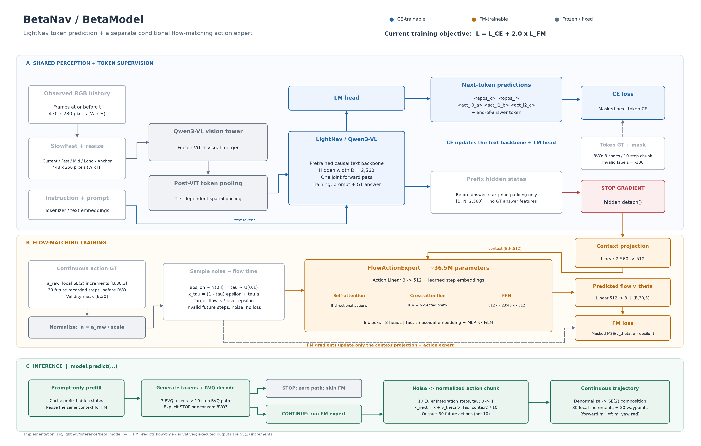

# 当前 BetaNav 架构图

依据 `src/lightnav/inference/beta_model.py`、当前训练配置及第18000步checkpoint元数据绘制。
源文件散列和架构参数记录在 [sources.json](sources.json)。

- [SVG 矢量图](betanav_architecture.svg)
- [PDF](betanav_architecture.pdf)
- [中文 Mermaid 源码](betanav_architecture.mmd)

蓝色模块由CE更新，橙色模块由FM更新，灰色视觉塔冻结。`detach`位于可训练context projection之前。
FM的上下文只含回答开始前的主干特征。训练只进行一次主干因果前向，GT回答不能影响更早的前缀位置。

Token分支包含apos、opos和三个RVQ token；RVQ对应10步量化动作，普通样本另有回答结束token参与CE。
FM使用量化前的30步连续GT。有效步上，输入是`x_tau=(1-tau)*epsilon+tau*a`，监督目标是`a-epsilon`；
未知尾部保留噪声并屏蔽loss，不把末帧训练为30步零动作。

动作专家宽512、6层、8头、FFN2048；每层含动作双向self-attention、上下文cross-attention和FFN，流时间经MLP/FiLM注入。
推理时复用prefill上下文，先由RVQ分支判定STOP；继续行再执行10次Euler积分，输出30步SE(2)局部增量及组合路点。
10次流积分与30个未来动作步是两个独立维度，流场也不是机器人的物理速度。

当前训练目标为`CE + 2.0 × FM`。`detach`隔离反向梯度，但CE训练会持续改变主干产生的上下文特征。
