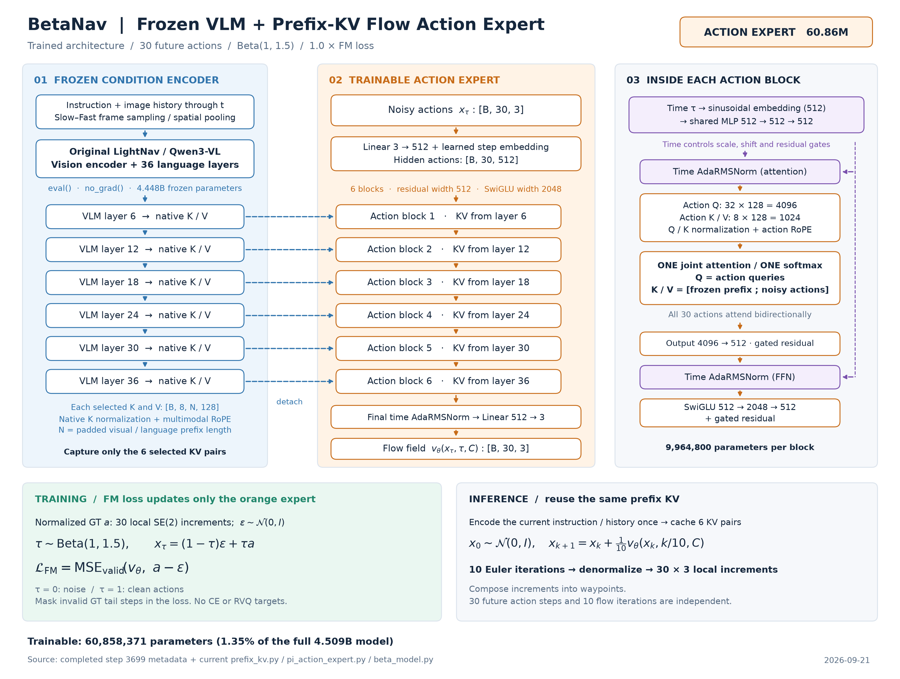

# BetaNav：冻结 VLM + Prefix KV + AdaRMSNorm 动作专家

依据已完成训练的 `r2r_fm_only_h30_prefix_kv_beta1_1p5` 第 3699 步元数据和实际模型代码绘制。
这份图对应新架构 `prefix_kv_v1`，不是早期 CE+FM / RVQ 版本。

[SVG 矢量图](betanav_prefix_kv_architecture.svg) · [PDF](betanav_prefix_kv_architecture.pdf) ·
[绘图代码](draw_architecture.py) · [参数计数](parameter_counts.json) · [来源散列](sources.json)

## 数据流

指令与截至当前时刻的图像历史，经过 Slow–Fast 采样、空间池化和冻结的原始 LightNav。
视觉编码器和 36 层语言主干均不更新；保留第 6、12、18、24、30、36 层的原生 K/V，
分别供 6 层动作专家读取。每个 K、V 的形状为 `[B,8,N,128]`，其中 N 是批内补齐的前缀长度。
原生 K 已经经过 key normalization 和 mRoPE；动作专家不对它重复归一化或旋转。

30 个带噪动作 `[B,30,3]` 经输入投影和步位置 embedding 变成 `[B,30,512]`。
每层动作 Query 对“前缀 K/V + 动作 K/V”做一次联合注意力。30 个动作之间双向可见；
前缀 padding 被屏蔽，GT 尾部的有效性 mask 只影响损失，不屏蔽动作 attention。
这版专家直接读取原生 K/V，没有旧版的 `context_proj`。

时间 τ 经正弦 embedding 和共享 MLP，生成供各层使用的时间特征。
attention、FFN 前的 AdaRMSNorm 分别生成 scale、shift、gate：

`h_norm = RMSNorm(h) * (1 + scale(τ)) + shift(τ)`

`h_next = h + gate(τ) * branch(h_norm)`

最终输出前另有不含 gate 的时间 AdaRMSNorm。各层调制器是独立可训练模块。

## 精确规模

在 meta device 上依据最终 checkpoint 配置构造专家，逐参数计数；不加载大权重、不占用 GPU。

| 组件 | 参数量 |
|---|---:|
| 六层联合注意力，含 Q/K RMSNorm | 31,458,816 |
| 六层 SwiGLU FFN | 18,874,368 |
| 全部 AdaRMSNorm 时间调制器，含最终输出归一化 | 9,980,928 |
| 共享时间 MLP | 525,312 |
| 输入投影、30 步 embedding、输出投影 | 18,947 |
| **总计** | **60,858,371** |

单个动作层为 9,964,800 参数，6 层合计 59,788,800；其余是共享输入、时间和输出模块。
残差宽度是 512，FFN 中间宽度是 2048，但 attention 的 Q 投影宽度是 4096（32×128），
K/V 各是 1024（8×128），最后投影回 512。不能用 512/32 推导本模型的 head dimension。

整个 BetaModel 共 4,509,200,899 参数；动作专家约占 1.35%，其余 4,448,342,528 参数冻结。
仅专家权重：BF16 约 116.08 MiB；当前 FP32 主参数约 232.16 MiB。
这不包含冻结 VLM、梯度、Adam、前缀 KV、视觉前向中间张量或 CUDA 缓存，不能当作训练总显存。

## 训练与推理

GT 是未来 30 步局部 SE(2) 增量，先按训练集 action scale 归一化为 a。
同一条动作序列共享一个 `τ ~ Beta(1,1.5)`，有效 GT 步上
`x_τ=(1−τ)ε+τa`；τ=0 是噪声，τ=1 是干净动作。
专家单次输出 `[B,30,3]` 流场，监督目标是 `a−ε`，仅有效动作参与 `1.0×FM MSE`。
不计算 CE 或 RVQ 标签损失，VLM 无梯度。

推理时，当前观测的前缀 K/V 只计算一次，10 次 Euler 积分重复使用它。
积分结果反归一化后是 30 步 `[前进米, 左移米, 逆时针转角弧度]` 局部增量，再通过 SE(2) 累积成路点。
**30 是未来动作数量，10 是流积分迭代次数；流场本身也不是机器人的物理速度。**
本图展示 FM 路径；当前 FM 训练没有额外 STOP 输出或 STOP loss。
