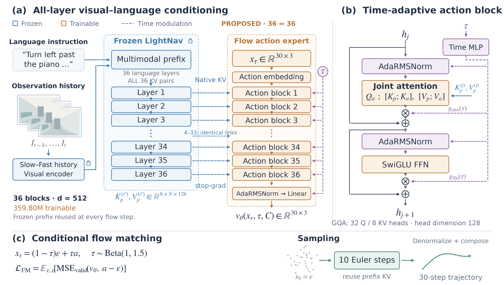
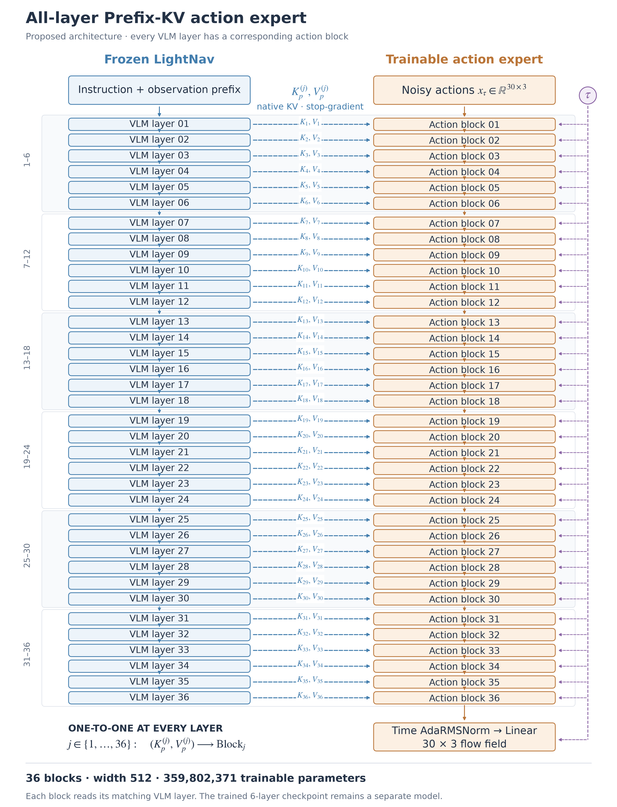

# All-layer Prefix KV：36 层一一对应方案

**状态：架构方案图。已完成训练的 checkpoint 仍是六层专家；本次没有改动训练配置或启动训练。**

论文排版版：[PDF](betanav_paper_architecture.pdf) · [SVG](betanav_paper_architecture.svg)

全部展开版：[PDF](betanav_all36_expanded.pdf) · [SVG](betanav_all36_expanded.svg)

## 读取关系

对每一层 `j=1,...,36`：

`Frozen VLM layer j → native (K_j, V_j) → Action expert block j`

36 层 VLM 的 K/V 全部使用，每个动作层读取它对应的一层 VLM K/V。
它们与该动作层自身生成的动作 K/V 拼接，供动作 Query 做一次联合注意力。
36 个动作层参数独立，不共享层权重；共享时间 MLP，保留各层独立 AdaRMSNorm 调制器。

这里没有让单个动作层同时拼接所有 36 层 VLM K/V；那会是另一种结构。
论文排版版只用省略号压缩重复结构，逐层展开版画出了 36 组连接。

## 规模与接口

| 项目 | 已训练版本 | 新方案 |
|---|---:|---:|
| VLM KV 选层 | 6,12,18,24,30,36 | 1–36 全部 |
| 动作专家层数 | 6 | 36 |
| 动作专家参数 | 60,858,371 | 359,802,371 |
| 整体模型参数 | 4,509,200,899 | 4,808,144,899 |
| 隐藏宽度 / FFN | 512 / 2048 | 512 / 2048 |
| 未来动作长度 | 30 | 30 |
| 推理 Euler 次数 | 10 | 10 |

计数依据当前 `PiFlowActionExpert`：在 meta device 上使用最终 checkpoint 配置，
只把层数改为 36、选层改为完整 `[1,...,36]`，不读取模型权重、不占用 GPU。
每个动作层 9,964,800 参数，共享输入、时间和输出模块共 1,069,571 参数。
新专家参数总计 `36×9,964,800+1,069,571=359,802,371`。

当前通用实现已支持这个一一对应关系，只需新配置匹配完整选层列表与 36 层专家。
六层 checkpoint 不能直接作为 36 层专家的精确恢复状态。
固定 batch、前缀长度和 dtype 时，缓存的前缀 K/V 容量是六层版的 6 倍；
这不意味着训练总显存或耗时也恰好变为 6 倍，实际 batch 需要重新测量。

## Suggested paper caption

**All-layer conditioning for a flow-matching navigation policy.**
(a) A frozen LightNav backbone supplies native keys and values from each of its 36 language
layers to the corresponding layer of a 36-block action expert. All conditioning tensors are
detached. Repeated connections are abbreviated only for display; no VLM layer is skipped.
(b) Each action block performs joint attention over the matching prefix KV and its own action
KV, with time-adaptive normalization and gated residual branches.
(c) The expert predicts a flow field over 30 future action increments; ten Euler updates reuse
the prefix KV for the current observation. Only the 359.80M-parameter expert is trainable.
This figure describes a proposed configuration, not the previously trained six-block model.

生成方式：`draw_paper_figure.py --all-layers`。历史图像、噪声与轨迹均为示意。
