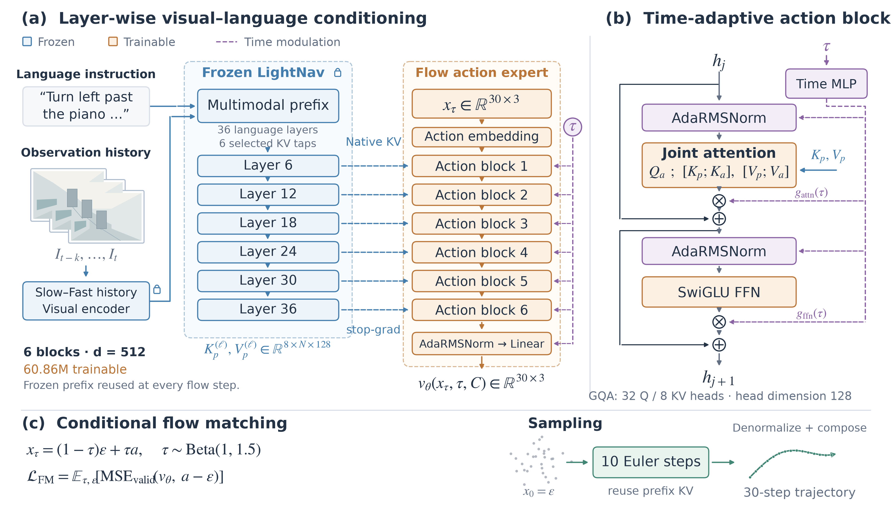

# BetaNav paper figure

- [Vector PDF](betanav_paper_architecture.pdf): 7.2 × 4.08 inches; embedded TrueType fonts.
- [Editable SVG](betanav_paper_architecture.svg): vector shapes and editable text.
- [PNG](betanav_paper_architecture.png): 3600 × 2040, rendered at 500 dpi.
- [Drawing source](../draw_paper_figure.py).

This revision removes run metadata and long implementation descriptions, aligns the six native KV
taps, and expands one action block into its actual gated residual computation graph.
Blue denotes frozen modules; orange denotes trainable action modules; purple denotes trainable
time modulation. Observation cards, noise samples, and the trajectory are schematic illustrations,
not dataset images or measured navigation results. Batch axes are omitted from tensor shapes.

## Suggested paper caption

**BetaNav with a frozen visual–language backbone and a time-adaptive flow action expert.**
(a) Six native key/value pairs from LightNav layers 6, 12, 18, 24, 30, and 36 condition the
corresponding action blocks without gradients to the backbone.
(b) Each block applies joint attention over prefix and action keys/values, with time-conditioned
AdaRMSNorm and gated attention/FFN residuals. All future action tokens attend bidirectionally.
(c) A masked flow-matching objective trains the expert on 30-step continuous action chunks;
MSE is averaged over valid action dimensions. At inference, ten Euler updates reuse the prefix
KV for the current observation. The resulting action increments are denormalized and composed
into a trajectory. Only the 60.86M-parameter action expert is trainable.

## 中文说明

主图保留“冻结 VLM → 六组原生 K/V → 六层动作专家”的核心结构；右侧展开单层的
AdaRMSNorm、联合 attention、SwiGLU 和两条带 gate 的残差路径。
底部区分训练目标与推理采样：输出流场经过 10 次积分得到 30 个动作增量，再反归一化并累积成轨迹。
图中的历史图像、噪声点和曲线均为示意，不表示模型评测结果。

架构、参数量和来源记录见[上一级说明](../README.md)。
