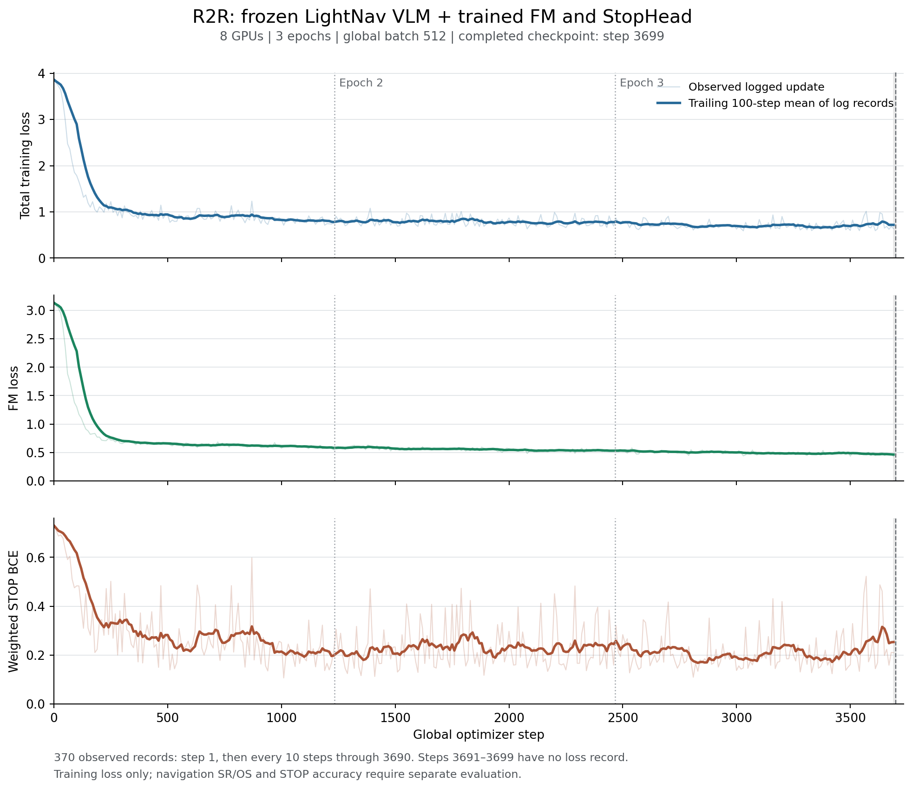

# R2R FM + StopHead training report

训练已完整完成 **3 个 epoch / 3,699 个 global step**，使用 8 张 GPU、全局 batch 512。
VLM 更新次数为 0；FM 与 StopHead 均更新 3,699 次。

原始运行目录：
`/mnt/cfs/Models/beta_nav/r2r_fm_stop_h30_prefix_kv_all36_beta1_1p5`。

完成依据是 `latest.json` 指向 `checkpoints/step-00003699`，该检查点存在
`COMPLETE` 标记，`metadata.json` 记录 `training_state_complete: true`，且
`trainer.json` 记录 `step: 3699`、`epoch: 3`、`batch_offset: 0`，与计划一致。
`COMPLETE` 文件修改时间为 **2026-09-27 14:04:39 UTC**（北京时间 22:04:39）。
该时间是检查点完成标记的文件时间，不是独立计时的进程退出时间。



| Loss | 首条记录 step 1 | 末条记录 step 3690 | 初始窗口均值 [1,100] | 末尾窗口均值 [3591,3690] |
| --- | ---: | ---: | ---: | ---: |
| Total | 3.859690 | 0.639874 | 2.900862 | 0.718333 |
| FM | 3.130455 | 0.430047 | 2.283378 | 0.464913 |
| STOP weighted BCE | 0.729235 | 0.209827 | 0.617485 | 0.253420 |

两项损失权重均为 1，故 Total = FM + STOP。
初始与末尾窗口分别包含 11 条和 10 条实际日志记录，其均值下降约
75.2%（Total）、79.6%（FM）、59.0%（STOP）。
FM 持续下降；STOP 在初期下降后仍有明显波动，不能仅据此宣称停止能力已经达标。

原始 `metrics.jsonl` 共 370 条记录：step 1 和每 10 步一次，最后记录为 3690。
没有缺失应记录的采样点；训练完成的最后 9 步没有独立 loss 日志，图中未补造这些值。
浅色线连接原始日志记录，深色线是在每个已记录 step `s` 上，对
`s - 100 < step <= s` 内已有记录取算术平均。它不是所有训练 update 的完整均值，
也没有对缺失的 step 插值。首条至末条 loss 日志相隔约 68.82 小时。

这些是训练集损失，不能替代导航 SR、OS、SPL 或独立的 STOP 准确率评估。
R2R 全部 episode 均用于本次训练，没有独立验证集。

## Artifacts and reproduction

- `loss_curves.png`：便于预览的图。
- `loss_curves.svg`、`loss_curves.pdf`：矢量格式。
- `summary.json`：精确统计、训练完成证据与源文件 SHA-256。
- `plot_losses.py`：只读原始日志和小型检查点元数据的可复现 CPU 绘图脚本。

在仓库根目录运行：

```bash
.venv-habitat/bin/python reports/betanav/fm_stop_training_20260928/plot_losses.py
```

此处仅复用已有环境中的 matplotlib 3.3.2 / numpy 1.23.5，
不启动 Habitat，不读取模型权重，不使用 GPU。也可用装有 matplotlib/numpy 的其他 Python：

```bash
python reports/betanav/fm_stop_training_20260928/plot_losses.py \
  --run-dir /mnt/cfs/Models/beta_nav/r2r_fm_stop_h30_prefix_kv_all36_beta1_1p5 \
  --output-dir reports/betanav/fm_stop_training_20260928 \
  --window-steps 100
```
